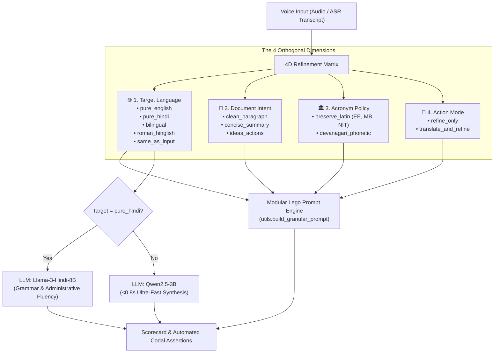

# ASR & Refinement Role Matrix Evaluator (v1.0)

This skill provides automated testing, benchmarking, and diagnosis for speech transcription (ASR) and LLM-driven document refinement across multilingual voice notes (English, Hindi, Devanagari Hinglish, and Roman Hinglish).

---

## 1. When to Use This Skill

Activate this skill whenever:
1. **Adding or Modifying an ASR Engine/Preset**: You download a new ASR model (e.g. Whisper Turbo, Conformer, Nemotron Q8, Sarvam) or adjust acoustic parameters (Vulkan/CUDA threads, temperature, prompt biasing).
2. **Adding or Modifying a Refinement Role Preset**: You create or tweak a goal preset (e.g. "Site Inspection Directive", "Audit Note", "Executive Brief").
3. **Refactoring Modular Prompt Lego Blocks**: You modify the granular prompt assembly (`Intent`, `Language`, `Acronym Policy`, `Contract`) in `utils.py` or template files.
4. **Evaluating LLM Selection & VRAM Footprint**: You benchmark new local Ollama models (e.g. testing whether a 3B/7B model can handle Hindi without token repetition loops or VRAM thrashing).
5. **Debugging Codal Violations**: An audio recording fails quality standards (dropped numbers, lost PWD acronyms like `EE`/`JE`/`MB`, or script contamination).

---

## 2. Architecture & The 4 Orthogonal Dimensions

Every refinement task is decomposed into 4 orthogonal dimensions:



---

## 3. Standard CLI Runbook

All benchmarks are decoupled from production code and located in `benchmarks/`.

### Quick Smoke Test (Dry Run)
Runs the entire matrix pipeline without making LLM API calls to verify data parsing and configuration integrity:
```bash
.venv/bin/python benchmarks/unified_benchmark.py --dry-run
```

### Full Benchmark Matrix Evaluation
Evaluates all representative audio scripts (`script1` to `script7`) across all 6 goals with batched LLM routing:
```bash
.venv/bin/python benchmarks/unified_benchmark.py
```

### Targeted Single-Script Debugging
Diagnose a specific audio recording against a specific goal (e.g. checking if `script5.wav` preserves technical terms under `ideas_actions`):
```bash
.venv/bin/python benchmarks/unified_benchmark.py --scripts script5 --goals ideas_actions
```

### Force ASR Re-transcription
By default, ASR transcripts are cached in `benchmarks/cache/asr_transcripts_cached.json`. To re-run raw audio models:
```bash
.venv/bin/python benchmarks/unified_benchmark.py --force-asr
```

---

## 4. The 5 Evaluation Pillars

### Pillar 1: ASR Preset Performance & Acoustic Compatibility
Evaluates Real-Time Factor (RTF) and acoustic language alignment:
- **`instant_english` (Nemotron 3.5 Streaming Q8)**: Target RTF < 0.05. **Strictly restricted to English speech**. ⚠️ **Fundamentally Invalid** for pure Hindi or code-mixed speech (hallucinates English phantom names like "David Smaphis" on Hindi phonemes).
- **`instant_hindi` (Nemotron 3.5 Streaming Q8)**: Target RTF < 0.05. **Optimal for Pure Hindi**. Outputs 100% Devanagari in <0.8s.
- **`smart_bilingual` (Whisper Large-v3-Turbo)**: Target RTF < 0.08. **Optimal for Bilingual Site Code-Mixing**. Accurately preserves mixed Devanagari Hindi + English technical terms (`EE`, `site visit`, `bridge foundation`). Viable for pure Hindi (~2.3s) but 3x slower than `instant_hindi`.
- **`roman_hinglish` (Apex Q8)**: Target RTF < 0.04. Transcribes speech phonetically into Roman Latin script. Ideal for WhatsApp/Slack workflows; suboptimal if target output is Devanagari (causes double-conversion overhead).

### Pillar 2: 4D Dimension Coverage & Language Translation
Verifies that changing one dimension does not unintentionally alter another:
- Changing **Document Intent** (`clean_paragraph` $\rightarrow$ `ideas_actions`) must alter structure without altering language or dropping technical acronyms.
- Changing **Target Language** (`pure_english` $\rightarrow$ `pure_hindi`) must switch scripts while keeping engineering acronyms in Latin script.
- **Cross-Lingual Equivalent Acceptance**: In automated codal assertions, when evaluating translated goals (`official_english`), assertions must accept official canonical translations (e.g. `Chief Engineer` for `मुख्य अभियंता`, `financial year` for `वित्तीय वर्ष`).

### Pillar 3: Role Component & Modular Lego Testing
When a prompt issue is detected, isolate the faulty component in `utils.build_granular_prompt()`:
1. `Intent Block`: Verifies formatting (`[Action Item]`, bulleted summary, or flowing narrative).
2. `Language Block`: Enforces script constraints (e.g. explicit Latin constraint for Roman Hinglish).
3. `Acronym Policy Block`: Protects PWD engineering terms (`EE`, `AE`, `JE`, `NIT`, `MB`, `RCC`, `M35`, `RA Bill`, `SOR`, `BOQ`).
4. `Contract Block`: Enforces zero conversational preamble and truthfulness.

### Pillar 4: Model Selection & VRAM Efficiency
- Verifies that `pure_hindi` routes to `SL-Lexicons/llama3-hindi-8b-q5_km.gguf:latest` to prevent infinite token loops.
- Verifies that all other modes route to `qwen2.5:3b` for sub-second generation.
- **VRAM Rule**: In batch testing, tasks must be grouped by model so Ollama loads each model into VRAM exactly once.

### Pillar 5: Automated Codal Assertion Guardrails
The evaluation engine automatically enforces:
- **Zero Hallucination Tokens**: Rejects forbidden tokens (`(IAR)`, `(REC)`, `(SUS)`).
- **Zero Garbage/CJK Characters**: Rejects unwanted Chinese characters.
- **Script Purity**: Rejects Devanagari in English/Roman modes; rejects Latin grammar in pure Hindi.
- **Number & Figure Invariance**: Asserts all numbers/chainages/quantities in speech are retained and none are fabricated.
- **Negation Invariance**: Verifies statements containing "नहीं" or "not" are never inverted.

---

## 5. Output Reports & Telemetry

Every run writes:
1. **Visual Scorecard**: `benchmarks/reports/BENCHMARK_SCORECARD.md` (Markdown table with pass/fail badges and side-by-side transcripts).
2. **JSON Telemetry**: `benchmarks/reports/unified_benchmark_results.json` (machine-readable metrics, RTF, latencies, and assertion logs).
