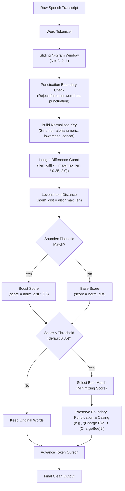

# Concept Documentation: Fuzzy N-Gram Domain Dictionary Engine

## 1. Executive Summary & Motivation

In automated speech recognition (ASR)—whether using Whisper, Nemotron, or Apex—technical jargon, domain acronyms, and proper nouns suffer from two distinct acoustic-to-text failure modes:

1. **Word-Boundary Fragmentation (Split Speech Tokens)**:
   - Spoken proper names or acronyms are split across multiple tokens:
     - Spoken `"ChatGPT"` $\rightarrow$ transcribed as `"Chat G P T"` or `"chat gpt"`
     - Spoken `"ChargeBee"` $\rightarrow$ transcribed as `"Charge B"`
     - Spoken `"OpenAI"` $\rightarrow$ transcribed as `"Open AI"`
     - Spoken `"MacBook Pro"` $\rightarrow$ transcribed as `"Mac Book Pro"`
     - Spoken `"DPR"` (Detailed Project Report) $\rightarrow$ transcribed as `"D P R"`
     - Spoken `"PMGSY"` $\rightarrow$ transcribed as `"P M G S Y"`
     - Spoken `"E-in-C"` $\rightarrow$ transcribed as `"e in c"`
2. **Phonetic Near-Misses & Accented Variations**:
   - Spoken `"culvert widening"` $\rightarrow$ transcribed as `"calvert winding"` or `"culvert white ink"`
   - Spoken `"R&D"` $\rightarrow$ transcribed as `"R and D"` or `"RD"`
   - Spoken `"earthwork"` $\rightarrow$ transcribed as `"arthwork"` or `"arth work"`

Traditional exact-string search dictionaries fail on split tokens because `"Chat G P T"` is 4 independent words separated by whitespace. Running a Large Language Model (LLM) after every short utterance just to reassemble known domain terms introduces **1.0 to 3.0 seconds of latency** and wastes GPU/CPU cycles.

The **Fuzzy N-Gram Domain Dictionary Engine** solves this problem by running an **in-memory, sub-millisecond ($<0.2\text{ ms}$) sliding n-gram matcher** immediately after raw transcription and before clipboard paste.

---

## 2. Theoretical Architecture & Handy Parity

The design follows the production-proven architecture from Handy's Rust audio toolkit (`Handy/src-tauri/src/audio_toolkit/text.rs`), ported natively to Python with zero external binary dependencies.



### 2.1 The Sliding N-Gram Window ($N \in \{1, 2, 3\}$)
At token position $i$, candidate windows of length $n \in \{3, 2, 1\}$ are examined in reverse order (longest first, or evaluating all three to pick the optimal global minimum score):
- $n = 3$: `"Chat G P"` or `"Mac Book Pro"` or `"e in c"`
- $n = 2$: `"Charge B"` or `"Open AI"` or `"R and"`
- $n = 1$: `"calvert"` or `"ee"` or `"mb"`

### 2.2 Punctuation Boundary Safeguard
If an internal token within an n-gram candidate contains closing punctuation (e.g., in `"Charge B, che"`, token `"B,"` has a comma), the candidate window is disqualified from consuming across the clause seam. Only leading punctuation on the first token and trailing punctuation on the final token are extracted and preserved.

### 2.3 Normalized Match Keys
- All alphanumeric characters are extracted and lowercased: `"Charge B"` $\rightarrow$ `"chargeb"`.
- Ampersand expansion: dictionary entry `"R&D"` generates dual match keys: `"rd"` and `"randd"`.

### 2.4 Length Difference Guard
To prevent a short word (e.g. `"AI"`) from matching a long dictionary term (e.g. `"OpenAI"`), candidates are rejected unless:
$$\Delta L \le \max(0.25 \times L_{\max},\; 2.0)$$
Where:
- $L_{\text{candidate}} = \text{length of normalized candidate}$
- $L_{\text{dict}} = \text{length of normalized dictionary term}$
- $\Delta L = |L_{\text{candidate}} - L_{\text{dict}}|$
- $L_{\max} = \max(L_{\text{candidate}}, L_{\text{dict}})$

### 2.5 Hybrid Distance & Soundex Phonetic Boost
Standard Levenshtein edit distance measures typographical distance:
$$\text{LevRatio} = \frac{\text{Levenshtein}(S_{\text{candidate}}, S_{\text{dict}})}{\max(\text{len}(S_{\text{candidate}}), \text{len}(S_{\text{dict}}))}$$

If both strings support Soundex phonetic encoding and their Soundex codes match:
$$\text{Score} = \text{LevRatio} \times 0.3 \quad (70\%\text{ discount/boost for phonetic matches})$$
Otherwise:
$$\text{Score} = \text{LevRatio}$$

A replacement is accepted only if $\text{Score} < \text{threshold}$ (default: `0.35`).

### 2.6 Boundary Punctuation and Case Pattern Preservation
- **Punctuation**: Prefix punctuation from token $0$ and suffix punctuation from token $n-1$ are preserved exactly:
  - `"(Charge B)?"` $\rightarrow$ prefix `"(",` suffix `")?"` $\rightarrow$ `"(ChargeBee)?"`
  - `"「Handee。」"` $\rightarrow$ prefix `"「",` suffix `"。」"` $\rightarrow$ `"「Handy。」"`
- **Casing**:
  - If original token was ALL-CAPS: replacement is converted to `UPPERCASE` (e.g. `"CHARGE B"` $\rightarrow$ `"CHARGEBEE"`).
  - If original token was Titlecase: replacement is converted to `Titlecase` (e.g. `"Charge b"` $\rightarrow$ `"ChargeBee"`).
  - Otherwise: original dictionary casing is retained.

---

## 3. Comprehensive ON vs. OFF Tradeoff Matrix

| Dimension | `ENABLE_FUZZY_CUSTOM_WORDS: true` (ON) | `ENABLE_FUZZY_CUSTOM_WORDS: false` (OFF) |
| :--- | :--- | :--- |
| **Execution Latency** | $<0.25\text{ ms}$ (in-memory string math) | $0.00\text{ ms}$ (bypassed) |
| **Acronym / Brand Repair** | **Automatic**: Multi-word splits (`"Chat G P T"`, `"Open AI"`, `"D P R"`, `"R and D"`) are repaired instantly. | **Broken**: Transcripts retain raw Whisper/Nemotron token splits unless corrected by an LLM prompt. |
| **Phonetic Corrections** | Accented near-misses (`"calvert winding"`, `"arthwork"`) match dictionary terms and normalize. | Unrecognized phonetic variations remain uncorrected in the transcript. |
| **Risk Profile** | Potential false positive if threshold is set too loose ($>0.5$). Mitigated by default `0.35` and $25\%$ length guard. | Zero risk of unwanted word substitution. |
| **LLM Dependency** | **Zero LLM needed**: Ideal for Instant/Dictation modes where speed is paramount. | Requires a secondary LLM refinement pass ($+1.5\text{s}$ to $+3.0\text{s}$) to fix terms. |
| **User Transparency** | Explicitly logged in debug logs and fully configurable via `config.json`. | Completely disabled; transcript is strictly verbatim ASR output. |

---

## 4. Dictionary Sources & Configuration

The engine aggregates three dictionary layers:
1. **Application Configuration (`config.json`)**:
   ```json
   "ENABLE_FUZZY_CUSTOM_WORDS": true,
   "FUZZY_MATCH_THRESHOLD": 0.35,
   "CUSTOM_WORDS": [
       "ChatGPT",
       "OpenAI",
       "Claude",
       "MacBook Pro",
       "ChargeBee",
       "GitHub",
       "DevOps"
   ]
   ```
2. **Domain-Specific Core Dictionary (`pwd_helper/pwd_dict.json`)**:
   Standard PWD engineering terms, designations, and abbreviations (`DPR`, `NIT`, `MB`, `EE`, `AE`, `JE`, `SE`, `CE`, `RCC`, `PCC`, `WBM`, `GSB`, `DBM`, `PMGSY`, `culvert widening`, `earthwork`, `sor`, `boq`).
3. **User Custom Extensions (`pwd_helper/pwd_custom_dict.json`)**:
   User-added office divisions, contractor names, local project titles, and regional designations.

---

## 5. Performance Benchmarks Target

- Dictionary size: $\approx 200\text{ words}$ (pre-indexed match keys)
- Processing time for a standard 30-word transcript: $\approx 80\text{ to }150\ \mu\text{s}$ ($0.08\text{ to }0.15\text{ ms}$)
- Memory overhead: $<100\text{ KB}$ for key hash tables.
