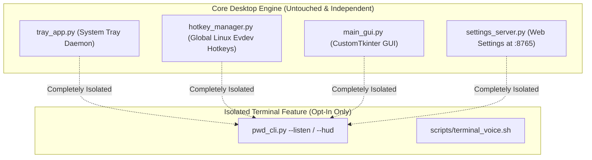

# Concept Documentation: Live Rich Terminal Dictation HUD & Shell Voice Alias

## 1. Executive Summary & Core Objective

**Live Rich Terminal Dictation HUD** is an optional, modular terminal interface designed for terminal power users, remote SSH developers, and engineers who work primarily within Bash, Zsh, or Tmux without opening a desktop GUI or browser.

It provides real-time visual microphone feedback, live audio VU level metering, and speech status transitions directly in the terminal window, with full UNIX pipe support (`./pwd_cli.py --listen | grep ...`).

---

## 2. Non-Interference Guarantee: Complete Subsystem Isolation

A primary concern when adding terminal visual tools is ensuring they **do not interfere with existing core systems**.



### Safety & Isolation Guarantees:
1. **Zero Side Effects on Background Daemons**: The existing `tray_app.py` background daemon, evdev global hotkeys (`Ctrl+Space`), and audio-to-idea services continue operating completely unmodified.
2. **Opt-In Invocation**: The Rich HUD runs **only** when specifically invoked from the command line (e.g. `python pwd_cli.py --listen` or typing `v` inside the `pwd_cli.py` interactive REPL).
3. **Graceful Dependency Fallback**: If the optional `rich` library is ever uninstalled, the CLI automatically falls back to clean, plain text printing with zero runtime errors.
4. **UNIX Pipe Safety (TTY Separation)**: When output is piped into another command or redirected to a file (e.g. `./pwd_cli.py --listen | git commit -F -`), the HUD output is automatically diverted to `stderr` or muted, ensuring `stdout` receives **only the pure, clean transcribed text**.

---

## 3. Visual Interface & Architecture

```
╭───────────────────── 🎙️ Voice Refiner Terminal HUD ─────────────────────╮
│                                                                          │
│  State:    ● RECORDING (Live VAD Active)                                 │
│  Mic VU:   [██████████████████░░░░░░░░░░░░░░░░] 58% RMS (Capturing)      │
│  Profile:  ⚡ Instant Pure Hindi (Nemotron)                              │
│  Goal:     🇬🇧 Official English Memo                                      │
│                                                                          │
│  Spoken:   "कल साइट पर निरीक्षण पूरा किया गया..."                         │
│  Output:   "Yesterday, the bridge site inspection was completed..."     │
│                                                                          │
╰──────────────────────────────────────────────────────────────────────────╯
```

### How It Works Under the Hood:
1. When `pwd_cli.py --listen` is started, an audio callback calculates real-time Root-Mean-Square (RMS) amplitude from incoming PCM chunks.
2. A `rich.live.Live` display refreshes the visual VU level bar and status indicator at 15–20 FPS with minimal CPU overhead ($<1\%$).
3. When silence is detected or audio finishes, status transitions smoothly to `● REFINING...` while Ollama / PWD dictionary runs.
4. The final refined text is emitted cleanly to stdout (and optionally copied to clipboard).

---

## 4. Transparent ON vs. OFF Tradeoff Guide

| Setting State | What You GAIN (Benefits) | What You LOSE / Potential Tradeoff | Recommended Use Case |
| :--- | :--- | :--- | :--- |
| **`CLI_RICH_HUD: true` (ON)** *(Default)* | • **Visual Microphone Assurance**: Live animated VU bar confirms mic is working and audio is not muted.<br>• **Clear Status Feedback**: Instant visual indicator of recording vs. transcribing vs. complete.<br>• **Modern Terminal UX**: Elegant Catppuccin-styled borders and color-coded labels. | • **Terminal Control Sequences**: Uses ANSI escape codes (which are automatically stripped if piped to a file or non-TTY). | Interactive terminal sessions, desktop bash/zsh prompts, remote SSH terminal work. |
| **`CLI_RICH_HUD: false` (OFF)** | • **Ultra-Minimal Output**: Prints plain, unadorned text lines with zero ANSI codes.<br>• **Lowest Possible Overhead**: Zero animation loops. | • **No Live VU Meter**: No visual indicator of mic audio volume during speech. | Headless servers, automated batch scripts, low-capability terminal emulators. |

---

## 5. Configuration & Usage Controls

### 1. In `config.json`:
```json
"CLI_RICH_HUD": true,
"FEATURES": {
    "terminal_rich_hud": true
}
```

### 2. Command Line Flags:
```bash
# Run with rich visual HUD:
python pwd_cli.py --listen

# Explicitly disable HUD (plain text only):
python pwd_cli.py --listen --no-hud

# Pipe refined text directly into git or a file:
python pwd_cli.py --listen --pipe | git commit -F -
python pwd_cli.py --listen --pipe > voice_note.txt
```

### 3. Optional Bash / Zsh Alias (`scripts/terminal_voice.sh`):
```bash
# Source once in your terminal (or optionally add to ~/.bashrc):
source scripts/terminal_voice.sh

# Now type 'v' to speak a command or query directly in your prompt:
v
```
