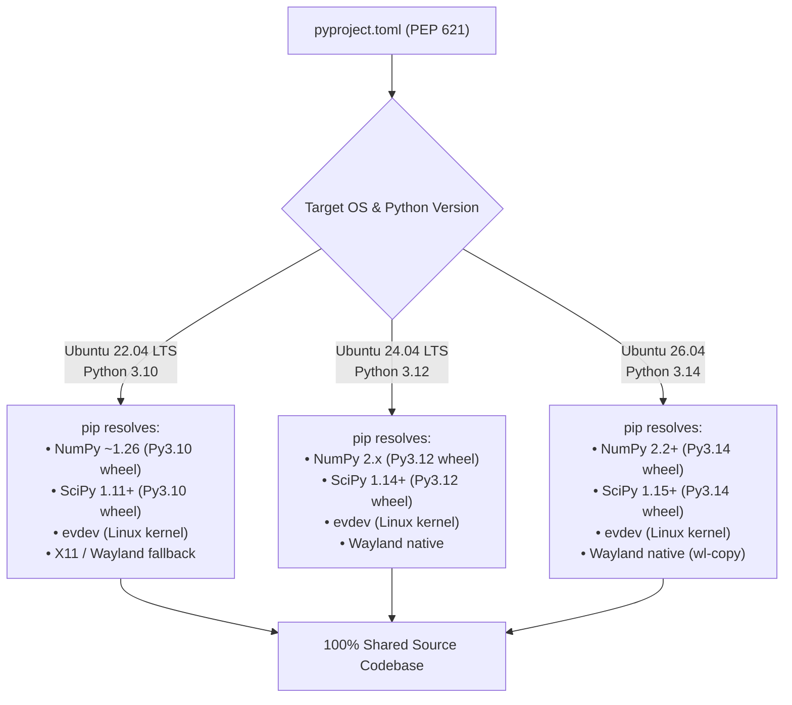

# Concept Documentation: Unified Dependency Modernization (`pyproject.toml`)

## 1. Executive Summary & Purpose

Prior to modernization, the repository used two disconnected, competing dependency specifications:
1. **Outdated `requirements.txt`**: Created in May with rigid pins (`==`) like `numpy==1.26.2` and `scipy==1.11.4`. These hard pins fail on modern distributions (such as Ubuntu 26.04 / Python 3.14) where NumPy 2.x wheels are standard. It was also missing essential modern modules like `evdev` (Wayland kernel push-to-talk), `transcribe_cpp` (GGML Vulkan engine), and `markdown` (offline documentation compiler).
2. **Narrow `pyproject.toml`**: Only covered the `audio-to-idea` batch module, completely omitting the primary voice assistant engine (`engine.py`, `tray_app.py`, `doctor.py`, `pwd_helper`, `settings_server.py`).

**Unified Dependency Modernization** establishes a single **PEP 621-compliant `pyproject.toml`** as the definitive source of truth across the entire codebase.

---

## 2. Multi-OS Architecture: Ubuntu 22.04 LTS vs. Ubuntu 26.04

A frequent question in Linux Python packaging is whether separate files are needed for different OS releases. **They are not.**



### Why a Single File Works:
- **Flexible Version Bounds (`>=`)**: By specifying `numpy>=1.24` and `scipy>=1.11` instead of `==`, `pip` automatically queries PyPI for the optimized binary wheel matching the running Python interpreter ($3.10 \le \text{version} \le 3.14$).
- **PEP 508 Environment Markers**: Platform-specific libraries are conditionally gated:
  ```toml
  "evdev>=1.6; sys_platform == 'linux'"
  "python-xlib>=0.29; sys_platform == 'linux'"
  ```
- **Unified C Libraries**: On both Ubuntu 22.04 and Ubuntu 26.04, the required host system packages are identical:
  ```bash
  sudo apt install -y python3-dev ffmpeg libvulkan1 wl-clipboard
  ```

---

## 3. Dependency Extras Architecture

The unified package defines granular installation tiers:

```
voice-to-refinedtext/
├── [core]           ──► Minimal headless dictation (numpy, sounddevice, scipy, requests, evdev, pystray, Pillow, ollama)
├── [gpu] / [vulkan] ──► Hardware-accelerated ASR (transcribe_cpp, faster-whisper, ctranslate2)
├── [gui]            ──► Desktop interfaces (customtkinter, darkdetect, pynput, python-xlib)
├── [docs]           ──► Offline manual compilation (markdown)
├── [test]           ──► Unit test suites (pytest, typeguard, pytest-cov)
└── [all]            ──► Everything combined for a zero-hassle complete install
```

### Installation Commands:
```bash
# Recommended: Full desktop experience with GPU ASR and GUI
pip install -e ".[all]"

# Headless / Terminal-only server install
pip install -e .

# Backwards-compatible legacy install
pip install -r requirements.txt
```

---

## 4. Standardized CLI Entry Points

Once installed, the project registers native console commands directly into the environment's `PATH`:

| Command | Entry Target | Purpose |
| :--- | :--- | :--- |
| **`voice-refiner`** | `tray_app:main` | Launches the background system tray daemon and hotkey listener. |
| **`voice-doctor`** | `doctor:main` | Runs the 24-check self-healing diagnostic suite in terminal. |
| **`audio2idea`** | `audio_to_idea.cli:main` | CLI batch audio transcription and concept extraction. |
| **`audio2idea-gui`** | `audio_to_idea.cli:gui_main` | Dedicated audio-to-idea graphical interface. |

---

## 5. Backwards-Compatible `requirements.txt` Shim

To ensure CI pipelines, docker builds, and existing shell scripts (`setup_shortcut.sh`) continue to work without modification, `requirements.txt` is updated to a modern PEP 621 shim:

```ini
# Backwards-compatible shim pointing to unified pyproject.toml
# Installs complete desktop assistant across Ubuntu 22.04 through 26.04
-e .[all]
```
