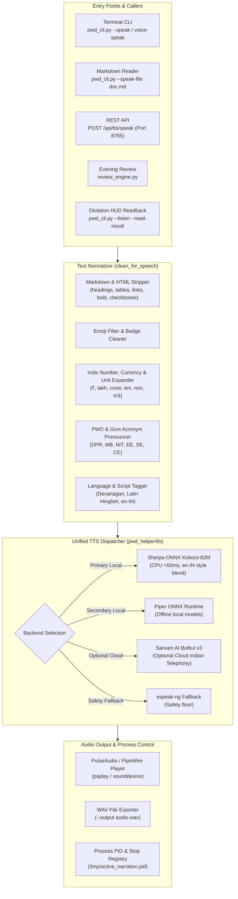

# Concept: Universal Modular Speech Synthesis & Multi-Interface TTS

**Author:** Antigravity  
**Target:** voice_to_refinedtext (`pwd_helper/tts/`, `pwd_cli.py`, `settings_server.py`, `review_engine.py`)  
**Status:** Architectural Specification  

---

## 1. Executive Summary

Voice-to-RefinedText has matured into a production-grade Indian English (`en-IN`) and Hindi voice dictation environment on Linux. However, speech output (TTS) remained historically trapped inside `review_engine.py`, relying on brittle subprocess calls to an unmaintained Piper binary or robotic `espeak-ng`. 

This architecture unifies all speech synthesis into an isolated, multi-backend, extensible **Universal TTS Engine** (`pwd_helper/tts/`). It brings:
1. **Multi-Interface Access**: Terminal CLI (`voice-speak`, `pwd_cli.py --speak`), Markdown file narration (`--speak-file note.md`), REST API (`POST /api/tts/speak`), and agent dictation read-backs (`pwd_cli.py -l -r`).
2. **Indian Speech & Hinglish Excellence**: Fast local CPU synthesis via `sherpa-onnx` (`Kokoro-82M` with voice embedding interpolation for `en-IN`), standalone Piper ONNX fallback, and pluggable cloud streaming via Sarvam AI (`Bulbul v3`).
3. **Robust Text Front-End Preprocessing**: Automatic Markdown stripping, emoji filtering, Indian currency expansion (`₹1.5 lakh` $\rightarrow$ "one point five lakh rupees"), and PWD technical acronym expansion.

---

## 2. Architecture & Data Flow



---

## 3. Core Architectural Pillars

### A. Dedicated Modular Package (`pwd_helper/tts/`)
Instead of duplicating `subprocess.Popen(["espeak-ng", ...])` inside `review_engine.py`:
- `pwd_helper/tts/normalizer.py`: Pure-function text cleaner, converting markdown, YAML, emojis, and Indian units into clean speech phonetics.
- `pwd_helper/tts/dispatcher.py`: Singleton `SpeechSynthesizer` that manages engine priority, concurrent playback locks, stop requests, and process tracking.
- `pwd_helper/tts/backends/`:
  - `piper_backend.py`: Direct python/ONNX runner or CLI wrapper with automatic binary resolution.
  - `sherpa_backend.py`: C++/ONNX ultra-low latency engine (`Kokoro-82M` / `MMS-TTS`).
  - `sarvam_backend.py`: Streaming cloud adapter for Sarvam `Bulbul v3` when internet and API key are configured.
  - `espeak_backend.py`: Universal zero-dependency fallback.

### B. Speech Normalization & Markdown Sanitization
When piping Markdown notes (e.g. from Obsidian daily notes or review summaries) into TTS, raw markdown characters break synthesis:
- `## Heading 2` $\rightarrow$ "Heading 2" (removes `#`).
- `- [ ] Draft DPR for Chamba bridge` $\rightarrow$ "To do: Draft DPR for Chamba bridge".
- `- [x] Completed site inspection` $\rightarrow$ "Completed: Completed site inspection".
- `₹1,50,000` $\rightarrow$ "one lakh fifty thousand rupees" or "एक लाख पचास हज़ार रुपये".
- `12.5 km` $\rightarrow$ "twelve point five kilometres".
- `**CRITICAL:**` $\rightarrow$ "Critical:".
- Strips URL links, markdown tables, badges, and emojis (`🚨`, `📋`, `✨`).

### C. Voice Embedding Interpolation for Indian English (`en-IN`)
As discovered in `deeper look into the Indian speech synthesis .md`:
- Standard American models (`en_US-ryan-high`) mispronounce Indian technical terms and local names.
- Native Hindi models (`hi_IN-priyamvada`) choke on English vocabulary.
- With `Kokoro-82M` on `sherpa-onnx`, 256-dimensional style vectors can be blended in RAM:
  $$\mathbf{v}_{\text{en-IN}} = 0.65 \cdot \mathbf{v}_{\text{Hindi}} + 0.35 \cdot \mathbf{v}_{\text{British/American}}$$
- This achieves authentic Indian English cadence without retraining heavy models.

---

## 4. Multi-Interface Touchpoints

### 1. Terminal CLI Commands
Add first-class speech commands to `pwd_cli.py`:
```bash
# Speak arbitrary text
python pwd_cli.py --speak "Bridge inspection report has been generated."

# Read Markdown document aloud (stripping frontmatter & formatting)
python pwd_cli.py --speak-file ~/learning_vault/"My Daily Notes"/2026-10-20.md

# Listen & Readback (Dictate hands-free, terminal speaks back refined output)
python pwd_cli.py --listen --read-result

# Stop active speech immediately
python pwd_cli.py --stop-speech
```

### 2. Shell Shortcut Integration
In `scripts/terminal_voice.sh` and `~/.zsh/aliases.zsh`:
```bash
alias v-speak='python pwd_cli.py --speak'
alias v-read='python pwd_cli.py --speak-file'
alias v-stop='python pwd_cli.py --stop-speech'
```

### 3. REST API (`settings_server.py`)
Expose lightweight endpoints on port `8765`:
- `POST /api/tts/speak`: Body `{ "text": "...", "lang": "auto", "blocking": false }`
- `POST /api/tts/stop`: Immediately terminates active playback.
- `GET /api/tts/status`: Returns current synthesizer backend, status (`idle` | `speaking`), and available voices.

### 4. Agent & Pipeline Interop
Agents and external automation scripts can invoke speech via standard UNIX piping:
```bash
cat note.md | python pwd_cli.py --speak-pipe
```

---

## 5. Security & Secrets Management Best Practice

Regarding the security finding for Telegram Bot credentials in `review_config.json`:
1. **Never store API tokens in tracked JSON configs.**
2. **Environment Variable Precedence**: `TELEGRAM_BOT_TOKEN` & `TELEGRAM_CHAT_ID`.
3. **Local Secrets File (`.secrets.json`)**: Ignored in `.gitignore`.
4. **Secret Scrubbing**: Replace hardcoded tokens in `review_config.json` with placeholder/env-redirection.
