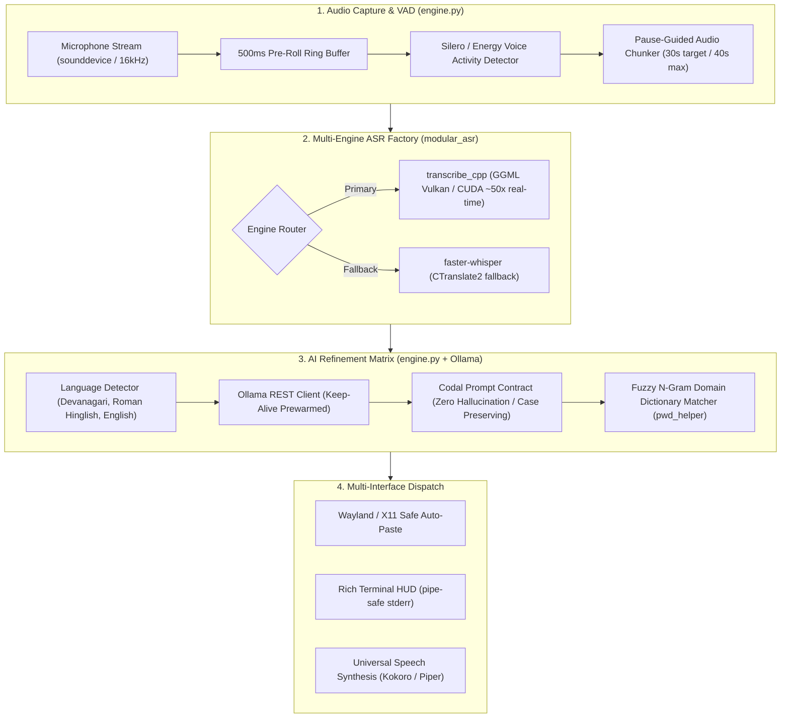

# AI Voice Refiner — Developer & Architecture Manual

**Target Audience:** Core Contributors, AI Engineers, Linux Systems Programmers  
**Language Standards:** Python 3.10 – 3.14 (PEP 621 `pyproject.toml`, PEP 563 annotations)  
**Testing Framework:** `pytest` (307+ tests, strict TDD approach)  

---

## 1. Architectural Blueprint & Data Flow

Voice-to-RefinedText is built as an asynchronous, low-latency audio processing pipeline designed to operate without sending any audio or text to third-party clouds.



---

## 2. Audio Capture Pipeline (`engine.py`)

### A. Pre-Roll Ring Buffer & Zero Word-Clipping
When a user activates voice dictation (either via hotkey or terminal `v`), standard microphone recording often chops off the initial consonant of the first word (e.g. *"ubmit"* instead of *"Submit"*).
- The pipeline maintains a continuous **500ms circular ring buffer** in memory (`PRE_ROLL_BUFFER_MS: 500`).
- When speech is detected, the audio chunk is prepended with the pre-roll buffer, guaranteeing 100% initial plosive retention.

### B. Pause-Guided Long Audio Chunking
For audio notes longer than 30 seconds:
- Rather than cutting arbitrarily at 30.0s (which clips words in half), the chunker locates natural silence pauses between **25.0s and 35.0s**.
- If a pause >250ms is located, the chunk boundary is set cleanly inside the silence gap.

---

## 3. Multi-Engine ASR Factory (`modular_asr/`)

The speech-to-text layer dynamically selects between hardware-accelerated runtimes:

1. **`transcribe_cpp` (GGML Vulkan / CUDA)**:
   - Uses GGML C++ kernels directly via Vulkan or CUDA.
   - Runs `large-v3-turbo`, `nemotron-0.6b`, or `whisper-apex` at **30x–50x real-time** speed with ~700MB VRAM footprint.
2. **`faster-whisper` (CTranslate2)**:
   - Used as a universal cross-platform fallback when Vulkan is unavailable.
   - Supports 8-bit quantization (`int8_float16`).

---

## 4. LLM Refinement Matrix & Dual Ollama Routing

Raw transcribed text often contains verbal disfluencies (*"um"*, *"ah"*, repetitions) or lacks punctuation:
- **English Routing**: Handled by fast, concise models (default: `qwen2.5:3b`).
- **Hindi / Hinglish Routing**: Handled by Indian-optimized weights (default: `SL-Lexicons/llama3-hindi-8b-q5_km.gguf:latest`).
- **Prompt Engineering Invariants**:
  - **Zero Hallucination**: Strict instruction prohibiting adding apologies, conversational preambles, or concluding thoughts.
  - **Case & Number Invariance**: Preserves technical acronyms (`DPR`, `MB`, `NIT`, `BOQ`) and numbers (`₹1.5 lakh`, `12.5 km`).
  - **Keep-Alive Prewarming**: LLM weights are kept hot in VRAM (`OLLAMA_KEEP_ALIVE: "60m"`) to eliminate the 3-second model load penalty on subsequent dictations.

---

## 5. Fuzzy N-Gram Domain Dictionary (`pwd_helper/fuzzy_matcher.py`)

Handles specialized domain vocabulary and technical terminology:
- Uses sliding $N$-grams ($N \in \{1..4\}$).
- Computes Levenshtein edit distance combined with a **Soundex phonetic match boost (0.3x)**.
- **Short-term exact guard**: Prevents false positive matching on short common words ($\le 3$ characters).

---

## 6. Universal Speech Synthesis (`pwd_helper/tts/`)

A decoupled, thread-safe speech synthesis engine:

1. **Text Normalization (`normalizer.py`)**:
   - Strips YAML frontmatter (`--- ... ---`), markdown headers, checkboxes, tables, and emojis.
   - Expands Indian currency (`₹1.5 lakh` $\rightarrow$ *"1.5 lakh rupees"*).
   - Expands engineering units (`km` $\rightarrow$ *"kilometres"*, `m3` $\rightarrow$ *"cubic metres"*).
2. **Voice Embedding Interpolation (Kokoro-82M)**:
   - Kokoro voices are 256-dimensional style tensors stored in `voices.bin`.
   - The engine computes:
     $$\mathbf{v}_{\text{en-IN}} = 0.80 \cdot \mathbf{v}_{\text{Hindi}} (\texttt{hf\_alpha}) + 0.20 \cdot \mathbf{v}_{\text{British}} (\texttt{bf\_emma})$$
   - Combined with Commonwealth English (`en-gb`) phonemizer, this produces authentic Indian broadcast English without American rhotic drawl.
3. **Process Lock & Instant Cancellation**:
   - Active playback PID is tracked in `/tmp/pwd_speech.pid`.
   - Any client calling `stop()` terminates playback instantly via `SIGTERM`.

---

## 7. Secrets Management (`pwd_helper/secrets.py`)

To prevent accidental exposure of Telegram bot tokens or API keys in git:
- Tracks credentials in local git-ignored `.secrets.json`.
- Precedence: Environment Variables $\rightarrow$ `.secrets.json` $\rightarrow$ `.env` $\rightarrow$ Runtime Config.

---

## 8. Test Suite & Verification Standards

The repository enforces strict test-driven development:
- **Total Tests**: 307+ automated tests across `tests/`.
- **Run all unit tests**:
  ```bash
  pytest tests/ -m "not desktop" -v
  ```
- **Live Manual Live-Sync**:
  Editing `docs/CONFIGURATION_GUIDE.md` automatically triggers `ManualService.generate_html_manual()`, keeping `docs/generated/manual.html` 100% in sync.
