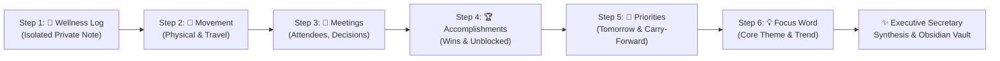

# Executive Evening Review Studio: Architecture, Capabilities & Operations Guide

## 1. Executive Summary & Vision

The **Executive Evening Review Studio** is an intelligent conversational journaling and productivity reflection system designed for high-impact professionals and civil engineering executives. 

Rather than filling out rigid forms or typing into blank notes, the user engages in an audio-guided conversation with an **AI Executive Secretary**. The system listens to spoken reflections, asks insightful follow-ups across 6 progressive steps, and synthesizes the entire conversation into a structured Obsidian daily note.

### The "Executive Secretary" Paradigm
A key strength of the Executive Secretary is **holistic contextual awareness**. When speaking freely, people often blend topics. For example:
> *"I drove to the Secretariat at 11 AM to meet the Chief Engineer regarding the Song River Bridge DPR, and we agreed to fast-track the tender notice."*

Instead of blindly dumping this into whichever step was active, the Executive Secretary automatically understands and cross-routes:
* 🚗 **Movement**: Journey from site/office to Secretariat
* 👥 **Meetings**: 11:00 AM meeting with Chief Engineer on Song River Bridge DPR
* 🎯 **Tomorrow's Priorities**: Fast-track tender notice / NIT

---

## 2. The 6-Step Guided Reflection Journey



### Step 1: 🌿 Wellness Log
* **Purpose**: Personal health, emotional energy, stress levels, and private reflections.
* **Storage Isolation**: To maintain absolute privacy, wellness notes are stored in a dedicated isolated file: `~/learning_vault/My Daily Notes/Wellness/YYYY/Month/YYYY-MM-DD.md`.
* **Behavior**: Written verbatim without LLM exposure or inclusion in general work notes.
* **Conversational Prompt**: *"मित्र, आज आपकी तबियत कैसी रही? कुछ निजी बात साझा करना चाहें तो बताइए"* / *"Any wellness notes or personal reflections for today?"*

### Step 2: 🚶 Movement & Field Activity
* **Purpose**: Tracks physical movement, site visits, inspections, commutes, and daily activity.
* **Default Fallback**: *"At office (no dedicated physical activity)"* if skipped.
* **Formatting**: Concise narrative summarizing locations and physical motion.

### Step 3: 👥 Meetings & Decisions
* **Purpose**: Captures key conferences, discussions, attendees, chairpersons, and decisions.
* **AI Extraction Format**:
  ```markdown
  **Meeting:** <short title or topic>
  - Time: <time if mentioned>
  - Place: <location if mentioned>
  - Attendees: <names or roles if mentioned>
  - Chairperson: <name if mentioned>
  - Discussion: <brief summary of what was discussed>
  - Decisions: <decisions taken, one per line starting with •>
  ```

### Step 4: 🏆 Accomplishments & Wins
* **Purpose**: Records completed deliverables, unblocked issues, approvals granted, and key milestones.
* **AI Extraction Format**: Numbered paragraphs starting with past-tense action verbs highlighting what was done and its impact.

### Step 5: 🎯 Tomorrow's Priorities & Carry-Forward Tasks
* **Purpose**: Establishes actionable priorities for tomorrow and audits lingering tasks from previous days.
* **7-Day Carry-Forward Matrix**:
  - Automatically scans past daily notes for unchecked `- [ ]` tasks.
  - Highlights aging tasks with status indicators: `⚠️ 3 days old`, `🚨 5 days critical`.
  - 1-click toggles: **✅ Mark Completed Today** or **📥 Carry Forward to Tomorrow**.
* **AI Extraction Format**: Standard Markdown checkbox list (`- [ ] task description`).

### Step 6: 💡 Core Focus Word & Trend
* **Purpose**: Captures the single overarching theme or focus word of the day (e.g. *Precision*, *Discipline*, *Coordination*).
* **Weekly Trend**: Appended to `focus_words.jsonl` to calculate 7-day sparkline frequencies and weekly focus reviews.

---

## 3. New Advanced Capabilities & Features

### A. Dual-Studio Split-View Canvas
* **Left Studio (Dialogue & Audio Capture)**:
  - Guided step progress bar with status indicators.
  - Conversational Voice Partner card showing the active prompt in both English and Hindi.
  - Piper TTS dynamic audio waveform displaying when the voice partner is speaking.
  - One-touch recording toggle (`Ctrl+Alt+V`).
  - Staged spoken clips buffer.
* **Right Studio (Live Obsidian Assembly & Context)**:
  - Context memory brief from previous 3 days (EN / HI toggle, Regenerate, Replay).
  - **Live Note Assembly Preview**: Shows `~/learning_vault/My Daily Notes/YYYY-MM-DD.md` dynamically rendering in real-time as each section is filled.
  - 7-day focus word trend sparkline.

### B. Staged Clips Tray with Inline Editing
* Spoken clips are staged in a visual buffer before being committed to LLM structuring.
* Users can view the raw transcribed text of each clip.
* **Inline Correction**: If Vulkan ASR misheard an acronym or person's name (e.g. "Song River" vs "Song"), the user can edit the text directly in the bubble.
* **Individual Clip Removal**: Erase accidental background chatter or coughs without resetting the entire step.

### C. Field Audio Upload & Site Memo Integration
* Enables importing voice memos recorded on mobile phones during site inspections or travel.
* Supports drag-and-drop or file picker for `.wav`, `.mp3`, `.m4a`, and `.ogg`.
* Automatically transcribed via Vulkan ASR and added to the step's staged clips.

### D. Intelligent Executive Secretary Synthesis
* When the 6 steps conclude, Ollama (`qwen2.5:3b` or configured `secretary_model`) processes the complete interview transcript.
* Organizes cross-cutting details, deduplicates notes, and produces clean Markdown blocks.
* Fallback resilience: If the local LLM encounters an issue, raw notes are safely written verbatim so no user thoughts are ever lost.

### E. Post-Review Delivery & Celebration
* Congratulates the user on completing the review and increments the consecutive daily streak (🔥 *5 Days in a Row!*).
* Quick Actions:
  - **📖 Open in Obsidian**: Automatically launches Obsidian at the newly created daily note.
  - **📋 Copy Full Note**: Copies formatted Markdown to clipboard.
  - **📱 Telegram Sync**: Automatically pushes the evening summary and tomorrow's morning brief to the user's private Telegram bot.

---

## 4. REST API & Backend Service Specification

The web studio is powered by `review_service.py` hosted on `http://127.0.0.1:8765`:

| Method | Endpoint | Description |
| :--- | :--- | :--- |
| `GET` | `/api/review/state` | Returns active review state, step index, accumulated clips, carry-forward tasks, and streak. |
| `POST` | `/api/review/start` | Initializes a new review for a given date (`date_str`), ensures vault directories, and starts context brief. |
| `POST` | `/api/review/record` | Toggles voice recording for the active step. |
| `POST` | `/api/review/stop` | Stops recording, runs Vulkan ASR transcription, and appends clip to stage. |
| `POST` | `/api/review/upload_clip` | Receives multipart audio file from mobile/site, transcribes, and stages clip. |
| `POST` | `/api/review/update_clip` | Updates or corrects text of an existing staged clip. |
| `POST` | `/api/review/delete_clip` | Removes a specific staged clip from the buffer. |
| `POST` | `/api/review/advance` | Advances to the next step, triggering LLM structuring or final synthesis. |
| `POST` | `/api/review/skip` | Skips current step, inserting default fallback content. |
| `POST` | `/api/review/redo` | Clears staged clips for the current step and re-prompts. |
| `POST` | `/api/review/cancel` | Safely aborts review and cleans up temporary state. |
| `GET` | `/api/review/note_preview` | Returns current rendered Markdown of the active daily note. |
| `POST` | `/api/review/resolve_task` | Marks an open task from previous days as completed or carried forward. |

---

## 5. Storage & Vault Paths

| Artifact | Location |
| :--- | :--- |
| **Daily Notes** | `~/learning_vault/My Daily Notes/YYYY/Month/YYYY-MM-DD.md` |
| **Wellness Notes** | `~/learning_vault/My Daily Notes/Wellness/YYYY/Month/YYYY-MM-DD.md` |
| **Focus Words Log** | `focus_words.jsonl` |
| **Review Logs** | `review_log.json` & `review_debug.log` |
| **Review Config** | `review_config.json` |
| **Morning Brief State** | `/tmp/morning_brief_state.json` |
