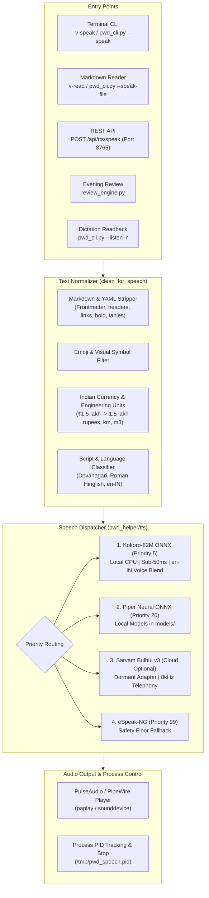

# Speech Synthesis (TTS) & Indian Voice Guide

**Target Version:** 2.0+ • **Platform:** Ubuntu 22.04 LTS – 26.04 LTS  
**Primary Engine:** Kokoro-82M ONNX (CPU Native) • **Fallback Engines:** Piper Neural ONNX / eSpeak-NG  

---

## 1. Overview & Architecture

Voice-to-RefinedText features a **100% local, offline-capable Universal Speech Synthesis subsystem** (`pwd_helper/tts/`). It brings natural, studio-quality speech synthesis directly to your Linux desktop without cloud fees or external dependencies.



---

## 2. North Indian Personas & Norm-Preserving SLERP

### A. Norm-Preserving SLERP Blending
Standard weighted averages (`0.65 * A + 0.35 * B`) shrink the vector magnitude (norm) in Kokoro's 256-dimensional StyleTTS2 latent space, which causes the voice to sound muffled or flat. 

The pipeline implements **Norm-Preserving Spherical Blending**:
$$\mathbf{v}_{\text{blended}} = \left( \frac{\sum w_i \mathbf{v}_i}{\left\| \sum w_i \mathbf{v}_i \right\|} \right) \cdot \left( \sum w_i \left\| \mathbf{v}_i \right\| \right)$$
This keeps vectors on the hypersphere surface across all 510 token positions, retaining crisp consonant articulation and natural emotional dynamic range.

### B. Six Tested North Indian Personas

| Profile Key | Style & Gender | SLERP Recipe | Acoustic Character |
| :--- | :--- | :--- | :--- |
| **`ni_delhi_corp_f`** *(or `en_in_female`)* | Delhi Corporate Female | `0.65 * hf_alpha + 0.35 * bf_emma` | Crisp urban North Indian English; clean retroflexes without American drawl. |
| **`ni_kahani_f`** | Warm Kahani / Storyteller Female | `0.60 * hf_beta + 0.25 * af_bella + 0.15 * bf_isabella` | Expressive micro-intonation with soft North Indian warmth (speed: 0.94). |
| **`ni_air_anchor_m`** *(or `en_in_male`)* | AIR / Doordarshan Male | `0.70 * hm_omega + 0.30 * bm_george` | Rich, authoritative North Indian broadcast baritone (speed: 0.95). |
| **`ni_ncr_tech_m`** | Noida / NCR Tech Explainer Male | `0.55 * hm_psi + 0.30 * bm_lewis + 0.15 * am_michael` | Upbeat, modern conversational male voice for technical loanwords. |
| **`ni_fm_rj_f`** | Delhi FM Radio Host Female | `0.50 * hf_alpha + 0.35 * af_heart + 0.15 * bf_alice` | High pitch variance and energetic delivery for lively prompts. |
| **`ni_docu_deep_m`** | Deep Documentary Male | `0.65 * hm_omega + 0.35 * am_adam` | Grounded, resonant low-end baritone for long-form narration (speed: 0.90). |

---

## 3. Indian Name Phonetics & Language Routing

### A. The Language Detection Guard
Previously, if a sentence contained a single Devanagari character (e.g. `मनोज`), naive regexes classified the entire English sentence as Hindi (`lang="hi"`). This forced Kokoro into Hindi mode with stock `hf_alpha`, completely discarding the user's requested voice vector and trying to read English words with Hindi phonemes—making the voice sound stilted, robotic, and identical across all personas.

The system now implements **Dominant Alphabet Language Routing** in [`pwd_helper/tts/normalizer.py`](file:///media/manoj/datadisk_linux/pythonprojects/voice_to_refinedtext/pwd_helper/tts/normalizer.py) and [`pwd_helper/tts/backends/kokoro_backend.py`](file:///media/manoj/datadisk_linux/pythonprojects/voice_to_refinedtext/pwd_helper/tts/backends/kokoro_backend.py):
1. **Character Ratio Analysis**: Text is classified as Hindi only if Devanagari characters dominate over Latin characters (`dev_count >= lat_count`), or if Roman-script Hinglish markers (`hai`, `karo`, `hoga`, etc.) are detected.
2. **Explicit Voice Retention**: An explicitly requested voice persona (e.g. `ni_air_anchor_m`, `ni_delhi_corp_f`) is **always honored**, regardless of whether the input is English, Hindi, or Hinglish.

### B. Two-Tier "Manoj" Pronunciation Fix
When standard English speech engines read Indian names (e.g. *Manoj*), they apply English phonetics, producing distorted pronunciations like *"Man-oddge"* (`mˈænɑːdʒ` in US, `mˈanɒdʒ` in GB).

The system solves this via **Phoneme-Space Substitution**:
1. When running in Commonwealth English mode (`en-gb`), Kokoro phonemizes the sentence.
2. The phoneme stream directly maps British `mˈanɒdʒ` and American `mˈænɑːdʒ` $\rightarrow$ North Indian **`mənˈoːdʒ`** (*Ma-nohj* with a pure long 'o' and soft dental 'j').
3. Common regional geographic names are likewise mapped: `ˈʊtɐɹɐkˌʌnd` $\rightarrow$ `ˈʊtɐɹəkˌʌnd` (*Uttarakhand*), `tʃˈeɪmbə` $\rightarrow$ `tʃˈəmbɑː` (*Chamba*), `dˌeəɹɐdˈuːn` $\rightarrow$ `dˈeːɦɹɑːdˌuːn` (*Dehradun*).
4. Kokoro synthesizes with `is_phonemes=True`, producing 100% natural North Indian pronunciation without altering the text or breaking English sentence phonemization.

---

## 4. How to Use in Your Daily Workflow

### A. Terminal CLI Shortcuts
Available from any folder in your terminal:

```bash
# 1. Speak arbitrary text with default Delhi Corporate Female voice:
v-speak "Superintending Engineer has verified the bridge foundation report."

# 2. Audition the North Indian personas:
python pwd_cli.py --speak "Good morning Manoj! Today we review the quarterly progress." --tts-voice ni_delhi_corp_f
python pwd_cli.py --speak "Good morning Manoj. Stories of Uttarakhand hills are truly timeless." --tts-voice ni_kahani_f
python pwd_cli.py --speak "Good morning Manoj! Hope your energy is on fire today." --tts-voice ni_fm_rj_f
python pwd_cli.py --speak "Good morning Manoj. We are deploying the audio synthesis pipeline." --tts-voice ni_ncr_tech_m
python pwd_cli.py --speak "Good morning Manoj, this is the official broadcast." --tts-voice ni_air_anchor_m
python pwd_cli.py --speak "Good morning Manoj, this is a deep documentary report." --tts-voice ni_docu_deep_m

# 3. Read an Obsidian Markdown note aloud:
v-read ~/learning_vault/"My Daily Notes"/2026-10-21.md

# 4. Dictate with hands-free audio confirmation:
v -r

# 5. Stop speech immediately:
v-stop
```

### B. UNIX Piping & Terminal Integration
Pipe command outputs, markdown summaries, or LLM agent responses directly into speech:

```bash
# 1. Pipe plain text or markdown to v-speak:
echo "Good morning Manoj! All 334 tests have passed." | v-speak

# 2. Read git commit message aloud:
git log -1 --pretty=%B | v-speak

# 3. Pipe agent or curl outputs into a specific voice:
curl -s http://localhost:8765/api/tts/voices | jq -r '.voices[].name' | python pwd_cli.py --speak - --tts-voice ni_air_anchor_m
```

### C. REST API (`settings_server.py:8765`)
External scripts, terminals, Obsidian plugins, or web apps can trigger speech via HTTP:

```bash
# 1. Query available voice personas:
curl -X GET http://127.0.0.1:8765/api/tts/voices

# 2. Synthesize text with a specific voice:
curl -X POST http://127.0.0.1:8765/api/tts/speak \
  -H "Content-Type: application/json" \
  -d '{"text": "Good morning Manoj. Inspection verified at ₹1.5 lakh.", "voice": "ni_air_anchor_m", "speed": 0.95}'

# 3. Stop active speech:
curl -X POST http://127.0.0.1:8765/api/tts/stop

# 4. Check synthesizer status:
curl -X GET http://127.0.0.1:8765/api/tts/status
```

---

## 5. Discovering & Creating Better Human-like Indian Voices (100% Local & Free)

If you want to discover even more human-like North Indian voices without purchasing cloud APIs:

### A. Interactive Hugging Face Voice Mixer
- Visit [Hugging Face Kokoro Voice Mixer](https://huggingface.co/spaces/ysharma/Make_Custom_Voices_With_KokoroTTS).
- Drag sliders between base Hindi vectors (`hf_alpha`, `hf_beta`, `hm_omega`, `hm_psi`) and Commonwealth/American vectors (`bf_emma`, `af_bella`, `bm_george`, `af_heart`).
- Listen to the resulting timbre instantly in your browser and copy the normalized weights directly into [`pwd_helper/tts/backends/kokoro_backend.py`](file:///media/manoj/datadisk_linux/pythonprojects/voice_to_refinedtext/pwd_helper/tts/backends/kokoro_backend.py).

### B. Clone Any Indian Speaker into a 256-dim Vector with `kvoicewalk`
Because Kokoro does not require heavy retraining to match a speaker, the open-source tool [`kvoicewalk`](https://github.com/RobViren/kvoicewalk) uses an optimization walk through Kokoro's 256-dimensional StyleTTS2 latent space:
1. Provide a **5 to 10-second clean `.wav` audio clip** of any North Indian speaker (your own voice, an AIR narrator, or a colleague).
2. `kvoicewalk` generates candidate Kokoro vectors, evaluates speaker acoustic similarity against the sample using WavLM/Resemblyzer, and outputs a tiny `~512 KB` `.npy` style vector.
3. Drop the `.npy` vector into your Kokoro model folder, and call it by name. It synthesizes at 50ms speed on standard CPU!

### C. Zero-Shot Diffusion Cloning via AI4Bharat `IndicF5`
To clone an Indian speaker with zero loss:
1. Use AI4Bharat's open-source `ai4bharat/IndicF5` (Flow-Matching Diffusion Transformer for Indian languages).
2. Runs locally on Linux CPU/Vulkan and captures regional cadence, accents, and emotional inflections.

### C. Optional Cloud Streaming (Sarvam AI Bulbul v3)
If you ever choose to use cloud telephony in the future:
1. Obtain an API key from Sarvam AI.
2. Add your key to `.secrets.json` (git-ignored):
   ```json
   {
     "sarvam_api_key": "YOUR_KEY_HERE"
   }
   ```
3. The codebase contains a dormant adapter that activates when `SARVAM_API_KEY` is present.

---

## 5. Developer Reference (`pwd_helper/tts/`)

- [`normalizer.py`](file:///media/manoj/datadisk_linux/pythonprojects/voice_to_refinedtext/pwd_helper/tts/normalizer.py): Pure functional text cleaner (`clean_for_speech()`, `expand_indian_currency()`, `detect_speech_language()`).
- [`dispatcher.py`](file:///media/manoj/datadisk_linux/pythonprojects/voice_to_refinedtext/pwd_helper/tts/dispatcher.py): Thread-safe `SpeechDispatcher` coordinating backends, playback process tracking via `/tmp/pwd_speech.pid`, and replay buffering.
- [`backends/kokoro_backend.py`](file:///media/manoj/datadisk_linux/pythonprojects/voice_to_refinedtext/pwd_helper/tts/backends/kokoro_backend.py): Kokoro ONNX runner with voice blending math.
- [`backends/piper_backend.py`](file:///media/manoj/datadisk_linux/pythonprojects/voice_to_refinedtext/pwd_helper/tts/backends/piper_backend.py): Piper neural runner for local `.onnx` models in `models/`.
- [`backends/espeak_backend.py`](file:///media/manoj/datadisk_linux/pythonprojects/voice_to_refinedtext/pwd_helper/tts/backends/espeak_backend.py): Robust fallback runner.
